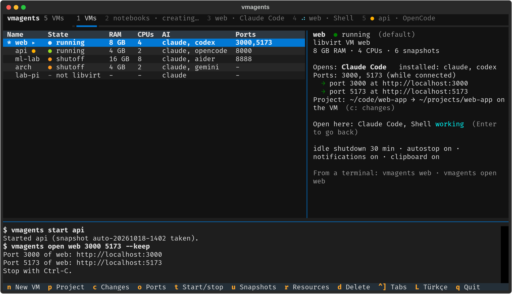
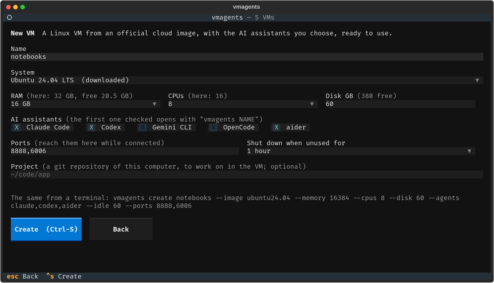
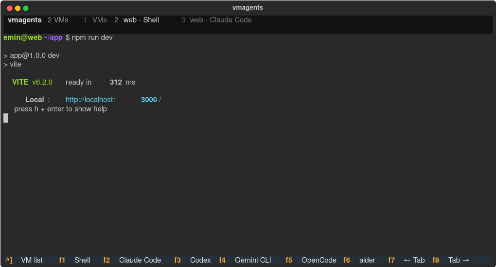
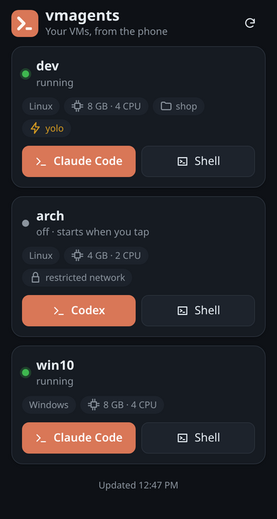
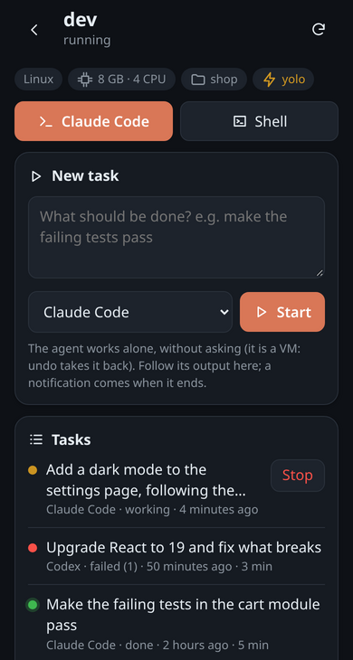
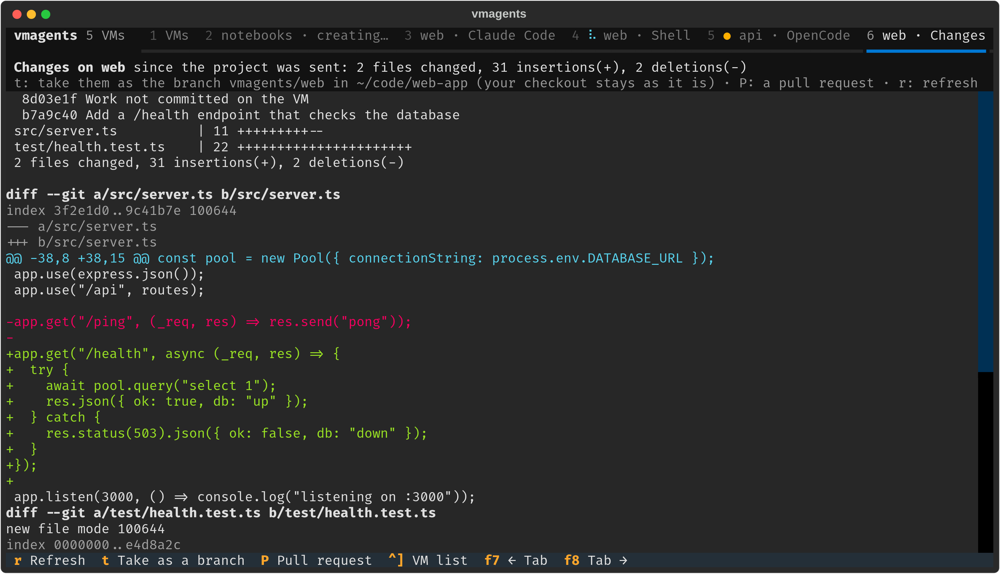

<div align="center">
  <h1>vmagents</h1>
  <p><i>Yapay zeka kodlama asistanlarını kendi bilgisayarında değil, bir sanal makinede çalıştır</i></p>

  [English](README.md) · **Türkçe**

  
  
  
  
  
  
  [](https://github.com/emincan2000/vmagents/actions/workflows/test.yml)

  [Kurulum](#kurulum) · [Hızlı başlangıç](#hızlı-başlangıç) · [Terminal arayüzü](#terminal-arayüzü) · [Görevler](#görevler-ve-sormadan-çalışma) · [Telefon](#telefondan) · [Projeler](#projeler) · [Issue'lar](#issuedan-pull-requeste) · [Komutlar](#komutlar) · [Yol haritası](ROADMAP.tr.md)
</div>

---

**vmagents**, Claude Code, Codex, Gemini CLI, OpenCode ya da aider'ı tek
komutla **bir sanal makinenin içinde** çalıştırır. Gerekirse VM'i başlatır, SSH
ile bağlanır ve asistanı orada açar: **Linux** VM'lerde tmux içinde (Claude Code
**Windows** VM'lerde de). Asistan senin bilgisayarının değil, VM'in dosya ve
programları üzerinde çalışır: istediğini kursun, çalıştırsın, bozsun; sonra
hepsini `vmagents undo` ile geri al.

```
$ vmagents
Starting VM dev...
Waiting for dev to get an IP address...
Waiting for SSH on 192.168.122.48:22...
 ╭──────────────────────────────────────╮
 │ ✻ Welcome to Claude Code!            │     ← VM'de, tmux içinde çalışıyor
```

Henüz VM'in yok mu? `vmagents create dev`, içinde Claude Code olan yeni bir
Debian VM'i kurar; imaj bir kez indikten sonra genelde yarım dakika ile iki
dakika arasında, tek bir şifre sorulmadan. Ya da her şeyi **terminal
arayüzünden** yap: `vmagents ui`



> vmagents'ın eski adı **vmclaude** idi. Eski komut çalışmaya devam eder;
> ayarlar ilk çalıştırmada kendiliğinden yeni yere taşınır.

## Özellikler

| | |
|---|---|
| **Tek komut** | `vmagents` (ya da `vmagents AD`) VM'i başlatır, bağlanır ve asistanı açar. |
| **Terminal arayüzü** | `vmagents ui`: VM oluştur (sistem, RAM, işlemci, disk, asistanlar, portlar), kabukları ve asistanları sekmelerde aç; anlık görüntüler, portlar, projeler. |
| **Görevi ver, git** | `vmagents run dev "başarısız testleri düzelt"`: bir asistan arka planda tek başına çalışır; bitince bildirim gelir. |
| **Bir görev, birkaç deneme** | `vmagents try dev 3 "görev"`: VM'in saniyeler içinde üç kopyası, her biri görevi yapar (istersen farklı asistanlarla); en iyisini alırsın. |
| **Kısa tasmalı ağ** | `vmagents net dev restricted`: VM yalnızca listesindeki adreslere (asistanların servisleri, paket depoları, GitHub) ulaşır; senin bilgisayarında uygulanır. |
| **Telefondan** | `vmagents phone` bir QR kod gösterir: okut, telefonun tarayıcısında VM'lerin listelenir; asistanlarını bir terminalde açar, görev verip izler, issue çözdürür, VM'leri başlatıp kapatır (Tailscale ile her yerden). SSH uygulamaları için de her VM'e bir port. |
| **Güvenle sormadan çalışma** | `vmagents yolo dev on`: asistanlar önce sormadan çalışır. Kendi bilgisayarında riskli; VM'de `undo` hepsini geri alır. |
| **Issue'dan pull request'e** | `vmagents fix dev 42 --test "npm test"`: asistan VM'de 42 numaralı GitHub issue'su üzerinde çalışır, testler orada çalışır (geçmezlerse çıktıları asistana geri gider), geçince bir pull request açılır. |
| **Projen, dal olarak geri** | `vmagents project` bir git deposunu VM'e gönderir, `vmagents take` asistanların işini dal ya da pull request olarak geri getirir. VM'de GitHub anahtarı gerekmez. |
| **İstediğin an yeni VM** | `vmagents create` resmî bir bulut imajından libvirt VM'i kurar (Debian 13, Debian 12, Ubuntu 24.04, Arch Linux); `--template node` (python, ml, go, rust ya da kendi şablonun) onu bir iş türüne göre hazırlar. |
| **Geri alma** | Her başlatmadan önce anlık görüntü alınır; `vmagents undo` VM'i oturumdan önceki hâline döndürür. |
| **Bağlantı kopsa da sürer** | Asistan tmux içinde çalışır. İnternet gitse, tekrar bağlan: aynı oturum. |
| **İşin bitince kapanır** | Asistandan çıkınca VM kapanır (hâlâ kullanılmıyorsa). Unutulan VM'ler 30 dakika boşta kalınca kendini kapatır. |
| **Bildirimler** | Claude VM'de izin istediğinde ya da seni beklediğinde masaüstü bildirimi. |
| **VM'deki sunucu tarayıcında** | `vmagents open dev 3000`, VM'in 3000 portunu buradaki bir port yapar. |
| **Claude'un geçmiş oturumları** | `vmagents history dev` Claude Code'un VM'deki konuşmalarını listeler, birini okunur biçimde gösterir; `--resume` onu sürdürür. |
| **Ortak pano** | Claude'un (ya da senin tmux'ta) VM'de kopyaladığı metin senin panona gelir. |
| **Beş asistan** | Claude Code, Codex, Gemini CLI, OpenCode, aider; ilk kullanımda kurulur. |
| **Tek adımda kurulum** | `vmagents setup` SSH anahtarını (VM şifresi bir kez sorulur), tmux'u, git'i ve Claude Code'u kurar. |
| **Her SSH girişi Claude'u açar** | Terminal, telefondaki SSH uygulaması, PuTTY, Termius; bir de uygulama menüsü kısayolu. |
| **Buradaki Claude Code, oradaki VM** | `vmagents mcp AD --add`, bilgisayarındaki Claude Code'a VM'de komut çalıştırma ve dosya düzenleme araçları verir. |
| **Windows VM'leri de** | SSH karşılamasından tanınır; kurulum Git for Windows'u ve Claude Code'u kurar. |
| **`vmagents doctor`** | Her adımı kontrol eder: VM durumu, IP, sshd, anahtarla giriş, Claude, tmux, otomatik başlatma. |

OpenSSH dışında bağımlılığı olmayan tek bir Bash betiği (libvirt VM'leri için
virsh, arayüz için Python gerekir). Birden çok VM, bir varsayılan, düz metin profiller.

## Kurulum

```sh
curl -fsSL https://raw.githubusercontent.com/emincan2000/vmagents/main/install.sh | bash
```

ya da depodan: `git clone https://github.com/emincan2000/vmagents && cd vmagents && ./install.sh`.
`vmagents`'ı `~/.local/bin` içine koyar; `./install.sh --uninstall` kaldırır.

Paket olarak: Debian ve Ubuntu'da [sürümler](https://github.com/emincan2000/vmagents/releases)
sayfasındaki `.deb` (`sudo apt install ./vmagents_*_all.deb`); Arch Linux'ta
[packaging/aur](packaging/aur) içindeki PKGBUILD (`cd packaging/aur && makepkg -si`).

**Gerekenler**

- **Bilgisayarın:** Linux, bash 4+, OpenSSH istemcisi. libvirt VM'leri için
  `virsh`. Arayüz için Textual ve pyte'lı Python 3; [uv](https://docs.astral.sh/uv/)
  kuruluysa `vmagents ui` bunları kendisi getirir.
- **Bir Linux VM:** SSH sunucusu, `curl` ve bir kez şifreyle girebilen (ya da
  anahtarın zaten olan) bir kullanıcı. `sudo` yalnızca paket kurmak için.
- **Bir Windows VM:** OpenSSH Sunucusu açık Windows 10 1809+ ya da 11; bkz.
  [Windows VM'leri](#windows-vmleri).

Her VM olur: libvirt/virt-manager/GNOME Boxes (qemu), VirtualBox, VMware,
Proxmox, bir bulut sunucusu. Yalnızca libvirt VM'lerini vmagents başlatır,
kapatır ve anlık görüntüsünü alır; diğerlerini kendin başlatıp adresini ver.

## Hızlı başlangıç

**Sıfırdan** (libvirt'li Linux):

```sh
vmagents create dev         # yeni Debian VM + Claude Code, şifre gerekmez
vmagents login dev          # Claude'a giriş (bu bilgisayardaki tarayıcınla)
vmagents dev                # içinde Claude Code'u aç
```

**Zaten bir VM'in varsa:** `vmagents`'ı argümansız çalıştır; ilk seferde VM
bilgilerini sorar ve kurulumu teklif eder. Ya da elle:

```sh
vmagents add dev --domain debian13 --user dev              # libvirt VM'i: gerektiğinde başlar, IP'si bulunur
vmagents add dev --host 192.168.1.50 --user dev            # başka herhangi bir VM
vmagents add vbox --host 127.0.0.1 --port 2222 --user dev  # VirtualBox NAT yönlendirmesi
vmagents setup dev          # anahtar, tmux, git, Claude Code, otomatik başlatma
vmagents                    # Claude Code'u VM'de aç
```

**Claude'a giriş:** `vmagents login dev`, tarayıcının olduğu bu bilgisayarda
`claude setup-token` çalıştırır ve uzun ömürlü token'ı VM'de
`~/.config/vmagents/claude-env` içine koyar (orada yalnızca sen okuyabilirsin).
Böylece VM'deki Claude, uzun bağlantısı terminalden kopyalanması zor olan giriş
ekranını hiç göstermez. Burada Claude Code ve bir Claude aboneliği gerekir; API
anahtarı da olur (`echo "$ANTHROPIC_API_KEY" | vmagents login dev`). Bu
token'lar sohbet ve kodlama içindir; diğer hesap özellikleri için Claude'da
`/login` kullan. `vmagents login dev --remove` siler.

| Giriş yolları | |
|---|---|
| Terminal | `vmagents` (varsayılan VM) ya da `vmagents dev` |
| Uygulama menüsü | `vmagents desktop dev`, **Claude Code (dev)** kısayolunu ekler |
| Herhangi bir SSH istemcisi | `ssh dev@VM` Claude'u açar (otomatik başlatma) |
| Claude değil, kabuk | `vmagents shell dev`, ya da Claude'dan çık / `Ctrl-b d` |

Her komutun örnekli kendi yardımı var: `vmagents help create`.

## Terminal arayüzü

```sh
vmagents ui
```

Liste VM'lerini durum, RAM, işlemci, yük (anlık işlemci kullanımı), asistan ve
portlarıyla gösterir; sağ taraf seçilenin ayrıntılarını, bu bilgisayarda
kapladığı bellekle birlikte. Her şey klavyeyle, Vim tuşlarıyla da çalışır
(`j`/`k` gezinme, `l` ya da Enter açma, `h` ya da Esc geri). `L` arayüzün
dilini değiştirir (English / Türkçe) ve seçim hatırlanır.

- **Yeni VM** (`n`): sistemi, RAM'i, işlemciyi, diski, asistanları, portları ve
  bir projeyi seç. Form çalıştıracağı `vmagents create` komutunu da gösterir;
  VM kendi sekmesinde kurulur, bu sırada liste kullanılabilir.
- **VM açmak** (Enter) nasıl açılacağını sorar: kabuk ya da bir asistan.
  **Arayüzün içinde**, bir terminal sekmesinde açılır; F1–F6 diğerlerini yan
  sekmelerde açar.
- **Tek sekme sırası:** önce VM listesi, sonra her terminal (hangi VM'de
  olursa olsun), kurulmakta olan her VM ve her projenin değişiklikleri.
  `Ctrl+]` listeye gider ve bulunduğun sekmeye geri döner.
- **Seni kim bekliyor:** bakmadığın bir terminal sekmesinde program çalışırken
  dönen bir işaret, durunca ya da zil çalınca bir nokta (●) görünür: asistan
  işini bitirdi ya da seni bekliyor. Listede o VM işaretlenir ve bir mesaj
  hangi sekme olduğunu söyler. Yalnızca terminale baktığı için her asistanda
  ve kabukta çalışır.

| Yeni VM | Sekmede Claude Code |
|---|---|
|  |  |

<details>
<summary><b>Tuşlar</b></summary>

| Listede | |
|---|---|
| `j` / `k` | aşağı / yukarı |
| `Enter`, `l` | aç: kabuk ya da bir asistan, terminal sekmesinde |
| `s` | VM'de hemen bir kabuk |
| `n` | yeni VM |
| `a` | bir asistana tek başına yapacağı bir görev; sekmede izlenir, bitince işaretlenir |
| `Y` | sormadan çalışma: asistanlar önce sormadan çalışır (bir kez onay ister), ya da yine sorsunlar |
| `x` | görevi VM'in kopyalarında dene (her biri bir sekmede izlenir); kopyalar varsa onları sil |
| `i` | ağ: bir adres listesiyle kısıtla; kısıtlıyken bir adrese izin ver (son reddedilen hazır gelir) ya da tekrar aç |
| `H` | Claude'un VM'deki geçmiş oturumları, bir sekmede: `j`/`k` ile gezin (altta gösterilir), `r` birini sürdürür |
| `p` / `c` | proje (git deposu) gönder / değişiklikleri sekmede (orada `t`: dal olarak al, `P`: pull request) |
| `f` | projenin bir GitHub issue'sunu çöz: numarası ve test komutu, sonra bir sekmede izlenir |
| `u` | anlık görüntüler: birine dön, ad ve etiketle yenisini al, etiketini değiştir, sil |
| `o` | portlar: şimdi yönlendir (`o` tekrar: durdur), her bağlantıda, ya da ağındaki cihazlara da |
| `t` / `r` | başlat ya da durdur / RAM ve işlemci (önce VM'i kapatır) |
| `d` | sil (adını yazarak onaylanır; vmagents ile kurulmamış VM'lerin yalnızca profili kalkar) |
| `L` | dil: English, Türkçe (hatırlanır) |
| `1` … `9` | o sekme (1 liste) |
| `Ctrl+]` | bulunduğun sekmeye dön |
| `q` | çık (terminal açıksa ya da VM kuruluyorsa önce sorar) |

| Terminal sekmesinde | |
|---|---|
| `F1` | kabuk |
| `F2` … `F6` | Claude Code, Codex, Gemini CLI, OpenCode, aider |
| `Ctrl+]` | liste |
| `F7` / `F8` | önceki / sonraki sekme (terminalin geçirdiği yerde `Ctrl+PgUp` / `Ctrl+PgDn` de) |
| diğer her şey | VM'e gider; fare tekerleği geriye kaydırır |

</details>

Arayüz yalnızca `vmagents`'ı çalıştırır ve `--json` çıktısını okur; yani yaptığı
her şey komut satırından da yapılabilir. Aynı betiğin içindeki bir
[Textual](https://textual.textualize.io/) uygulamasıdır, terminal olarak
[pyte](https://github.com/selectel/pyte) kullanır (uv yoksa:
`pip install --user 'textual>=8' pyte`).

## Görevler ve sormadan çalışma

Asistanlar bir komut çalıştırmadan ya da dosya değiştirmeden önce sorar; çünkü
kendi bilgisayarında yanlış bir adım zarar verebilir. VM'de veremez: yaptıkları
orada kalır ve `vmagents undo` VM'i başlarken alınan anlık görüntüye döndürür.
O zaman bırak çalışsınlar:

```sh
vmagents yolo dev on                    # bundan sonra dev'deki asistanlar önce sormadan çalışır
vmagents dev --yolo                     # ya da yalnızca bu sefer (--ask: tersi)

vmagents run dev "başarısız testleri düzelt"     # bir görev: asistan arka planda tek başına çalışır
vmagents run dev --codex --wait -- "bir --verbose seçeneği ekle"   # başka asistan; burada izle
vmagents runs dev                       # görevler: çalışıyor, bitti, başarısız
vmagents runs dev 3 -f                  # bir görevin çıktısı, bitene kadar izlenir
```

| Asistan | Sormadan çalışma seçeneği | Görev şöyle çalışır |
|---|---|---|
| Claude Code | `--dangerously-skip-permissions` | `claude -p` (adımları satır satır gösterilir) |
| Codex | `--dangerously-bypass-approvals-and-sandbox` | `codex exec` |
| Gemini CLI | `--yolo` | `gemini -p` |
| OpenCode | `--auto` | `opencode run --auto` |
| aider | `--yes-always` | `aider --message` |

Görev VM'de kendi tmux oturumunda çalışır; bilgisayarın bağlantıyı kesse ya da
uyusa da sürer, bitince masaüstü bildirimi gelir. Soruları cevaplayacak kimse
olmadığı için görevler her zaman sormadan çalışır. Kapalı bir VM başlatılır ve
iş bitince yine kapatılır; görev sürerken otomatik kapanma ve boşta kapanma VM'i
açık bırakır. Bir [projeyle](#projeler) birlikte `vmagents changes` ve `take`
sonucu dal olarak geri getirir. Arayüzde `a` görev verir ve onu bir sekmede izler.

Görevler Windows VM'lerinde de çalışır (yalnızca Claude Code): orada tmux
olmadığı için görev WMI ile başlatılan kendi Windows sürecini alır ve bağlantı
kopunca da sürer. `runs` onu aynı şekilde gösterir, izler ve durdurur; durdurunca
başlattığı her şey de kapanır.

## Bir görevi birkaç kez dene

```sh
vmagents try dev 3 "ana sayfayı hızlandır"                   # 3 kopya, her biri görevi yapar
vmagents try dev 2 --agents claude,codex -- "42 numaralı hatayı düzelt"   # birinde Claude Code, ötekinde Codex
vmagents tries dev                     # kopyalar ve neyi değiştirdikleri
vmagents changes dev-t2                # birine bak
vmagents take dev-t2                   # en iyisi, projende bir dal olarak
vmagents try dev --clean               # kopyaları sil (aldığın dallar kalır)
```

Kopyalar (`dev-t1`, `dev-t2`, ...) saniyeler sürer: libvirt VM'in diskini
kopyalar; disk indirilen taban imajı paylaştığı için yalnızca VM'de değişenler
kopyalanır. Her kopya bir kez yeni bir cloud-init örneği olarak açılır; böylece
kendi adını, makine kimliğini, ağ adresini ve SSH anahtarlarını alır, sonra
görevi [`vmagents run`](#görevler-ve-sormadan-çalışma) gibi yapar ve bitince
kapanır. Aynı anda çalıştıkları için bellekleri burada boş olmalı (`--memory MB`
her birine daha az verir). Kopyalanırken VM'in kendisi kapalı olmalı (`--stop`
önce kapatır). Kopyalar yalnızca `vmagents create` ile kurulmuş VM'lerden alınır.

## Kısıtlı ağ

Sormadan çalışan bir asistan, gitmemesi gereken yere bir şey gönderebilir ya da
indirmemesi gerekeni indirebilir. VM'in ağını kısıtlarsan yalnızca listesindeki
adreslere ulaşır:

```sh
vmagents net dev restricted          # bundan sonra yalnızca listedeki adresler
vmagents net dev                     # liste ve son reddedilenler
vmagents net dev allow api.example.com *.internal.test   # daha fazlası (başka port için ADRES:PORT)
vmagents net dev deny github.com     # daha azı
vmagents net dev open                # yine her yer
```

Liste asistanların servisleri ve kurucuları, paket depoları (npm, PyPI,
crates.io, Go, Debian, Ubuntu, Arch) ve GitHub ile başlar; aynı zamanda bir
dosyadır: `~/.config/vmagents/net/AD.allow`. Senin bilgisayarında, VM'in içinden
değiştirilemeyecek yerde uygulanır: VM'in ağ kartındaki bir libvirt ağ filtresi
yalnızca SSH, DHCP, DNS ve vmagents'ın bu bilgisayarda VM için çalıştırdığı
küçük bir vekili geçirir; vekil de HTTP ve HTTPS'i yalnızca listedeki adreslere
geçirir. VM'de vekil ayarları asistanların, git'in, npm'in, pip'in ve apt ya da
pacman'ın onu kullanmasını sağlar. VM'in libvirt ağı ve diğer VM'lerin
değişmez. Burada python3 gerekir; ufw gibi bir güvenlik duvarı varsa VM ağının
bu bilgisayara vekilin portundan (18080 ve sonrası) ulaşmasına izin ver.
Arayüzde `i` kısıtlar, bir adrese izin verir ya da açar.

## Telefondan

```sh
vmagents phone                         # bir QR kod: telefonun kamerasıyla okut
vmagents phone ssh dev "ssh-ed25519 AAAA... termius"   # ya da bir SSH uygulaması (açık anahtarıyla)
vmagents phone off                     # yeniden kapat
```

Telefonun tarayıcısında VM'lerinin olduğu bir sayfa açılır; birine dokun,
asistanı ya da bir kabuk telefonda bir terminalde (xterm.js) açılsın. Bu,
bilgisayarındaki oturumun aynısıdır: asistan VM'de tmux'ta çalışır, yani masada
bir şey başlat, koltuktan bak. Kapalı bir VM başlatılır. Bir çubuk telefon
klavyesinde olmayan tuşları verir (Esc, Tab, Shift+Tab, Ctrl, oklar); altındaki
kutu bütün bir mesajı tek seferde gönderir, böylece telefonun kendi klavyesi,
otomatik düzeltmesi ve sesle yazması çalışır. Çubuktaki bir tuş yazdığından sonra
gider; bir dosya adının başını yaz, tamamlamak için Tab'a dokun. Telefon uyanınca sayfa kendiliğinden
yeniden bağlanır.

Gerisi için bir VM'in adına dokun: ona bir görev ver ve çalışırken çıktısını
izle (önceki görevler de oradadır, çalışan bir görev durdurulabilir), projesinin
bir GitHub issue'sunu çözdür ([`vmagents fix`](#issuedan-pull-requeste)), ya da
VM'i başlat ve kapat. Ana ekrana eklenince (tarayıcının menüsünden) sayfa
simgesiyle ve tam ekran, bir uygulama gibi açılır. Telefona uyarak açık ya da
koyu görünür.

| VM'ler | Bir VM |
|---|---|
|  |  |

Sayfa senin bilgisayarında çalışan küçük bir web sunucusudur ve
[Tailscale](https://tailscale.com) (ücretsiz) üzerinden erişilir: şifreli, her
yerden, internete hiçbir şey açılmaz. Bilgisayara kur
(`curl -fsSL https://tailscale.com/install.sh | sh`, sonra `sudo tailscale up`),
telefona da uygulamasını aynı hesapla kur. Yalnızca aynı Wi-Fi'da mı?
`vmagents phone --lan` (o zaman şifresizdir; okul ve otel ağları cihazların
birbirini görmesini çoğu zaman engeller). QR koddaki bağlantı rastgele bir anahtar
taşır, sunucu onsuz hiçbir şeye cevap vermez; `--new` yenisini yapar. Kimin
bağlandığı `~/.cache/vmagents/phone.log`'a yazılır. Arayüzde: `m`. Sayfanın
terminali (xterm.js) de senin bilgisayarından gelir; bir kez indirilir ve özetine
bakılarak doğrulanır, yani aynı Wi-Fi'da telefonun internete çıkması gerekmez.

SSH uygulamaları (Termius, Blink, JuiceSSH) da çalışır: `phone ssh AD ANAHTAR`
uygulamanın açık anahtarını VM'e koyar ve ona bilgisayarında bir port verir
(7701, ...); bu port VM'in SSH sunucusuna gider, VM kapalıysa önce başlatır.
Otomatik başlatma açıksa girişte Claude Code açılır.

## Projeler

Asistanların bilgisayarındaki bir depo üzerinde VM'de çalışmasını, yaptıklarını
da dal olarak geri almayı sağlar:

```sh
vmagents project dev ~/code/app   # gönder: VM'de ~/projects/app; asistanlar orada açılır
vmagents dev                      # ...asistan çalışır (her şeyi çalıştırabilir: bu bir VM)
vmagents changes dev              # neyi değiştirdi: commit'leri ve commit'lemedikleri
vmagents take dev                 # hepsi ~/code/app içinde vmagents/dev dalı olur
git merge vmagents/dev            # ya da: vmagents take dev --pr (gh ile pull request)
vmagents project dev              # sonucu (ve senin yeni commit'lerini) geri gönder
```

- Commit'ler git bundle olarak vmagents'ın SSH bağlantısıyla gider: VM'in
  GitHub'a erişmesi ya da anahtar taşıması gerekmez; VM'e yalnızca commit'lenmiş iş gider.
- `take` yalnızca bir dal oluşturur ya da taşır; çalışma kopyana dokunmaz.
  VM'de commit'lenmemiş iş (yeni dosyalar da; `node_modules` gibi yok
  sayılanlar hariç) asistanın commit'lerinin üstüne bir commit olarak gelir.
- Yeniden göndermek VM'deki kopyayı değiştirir; bu yüzden VM'de geri
  alınmamış iş varken reddedilir. `--discard` yine de gönderir ve o işi VM'de
  `refs/vmagents/discarded/` altında saklar.
- `vmagents create web --project ~/code/app` projesi içinde hazır bir VM kurar.
  Arayüzde: `p` gönderir, `c` değişiklikleri bir sekmede gösterir (`t` al, `P` pull request).



## Issue'dan pull request'e

VM'de bir proje varken tek komut bir GitHub issue'sunu pull request'e kadar
götürür, sen başka bir şeyle uğraşırken:

```sh
vmagents fix dev 42 --test "npm test"
```

1. Issue ve yorumları burada, GitHub CLI (`gh`) ile okunur.
2. Proje VM'e yeniden gider: burada açık olan dalın temiz bir kopyası.
3. Asistan issue'yu görev olarak alır (`vmagents run`): düzelt ve commit'le.
4. Testler VM'de çalışır. Geçmezlerse çıktıları asistana gider ve yeniden
   dener (`--tries`, varsayılan toplam 2).
5. Asistanın commit'leri `vmagents/issue-42` dalı olarak geri gelir.
6. Testler geçince dal gönderilir ve gönderilen dala karşı "Fixes #42" diyen
   bir pull request açılır (`--draft`, ya da dalda durmak için `--no-pr`).

- `--test` bir sonraki issue için saklanır. Verilmezse asistan bulduğu
  testleri çalıştırır ve pull request vmagents'ın denetlemediğini söyler.
- Yalnızca asistanın commit'leri alınır; ortada bıraktıkları (önbellekler,
  test raporları) dışarıda kalır, hiç commit'lemediyse başka.
- VM hiçbir zaman GitHub'a bağlanmaz: issue'nun metnini alır, iş de `take`
  gibi vmagents üzerinden geri gelir. Asistan o metne sormadan uyar; bu yüzden
  bir kısmını senden başkaları yazdıysa `fix` kimlerin yazdığını söyler ve önce
  sorar (`--yes` sormaz).
- Her asistanla: `--codex`, `--gemini`, `--opencode`, `--aider`. Arayüzde: `f`.

## Günlük kullanım

### Çıkınca

libvirt VM'lerinde asistandan çıkınca (`/exit` ya da iki kez `Ctrl-C`) VM
düzgünce (ACPI ile) kapatılır ve kapanması beklenir. Hâlâ kullanılıyorsa açık
kalır ve nedenini söyler:

- asistan, `Ctrl-b d` ile ayrıldığın için tmux'ta çalışıyorsa (`vmagents dev` geri götürür);
- başka bir vmagents bağlantısı açıksa (`vmagents shell`, `mount`, ikinci bir `vmagents dev`);
- VM'de biri oturum açmışsa (SSH; Windows'ta ekran) ya da Claude orada hâlâ çalışıyorsa;
- bağlantı bitmek yerine koptuysa.

`vmagents dev --keep` bu seferlik açık bırakır, `vmagents autostop dev off`
her zaman. `vmagents stop dev` kapatır (`--force` fişi çeker),
`vmagents start dev` önceden başlatır, `vmagents list` hangilerinin açık
olduğunu gösterir. Yalnızca `--host` ile eklenen makineler hiç kapatılmaz.

**…ve unutursan:** `vmagents idle dev 30` VM'e küçük bir servis kurar; VM 30
dakika boyunca kullanılmazsa kendini kapatır (`create` bunu kendisi kurar).
Kullanılıyor demek: Linux'ta bir SSH oturumu, konsolda giriş, çalışan Claude
(kancalarından) ya da meşgul işlemci; Windows'ta bir SSH bağlantısı, oturum
açmış biri ya da çalışan Claude. Seni bekleyen Claude kullanılmıyor sayılır:
konuşması saklanır, `vmagents dev --continue` devam ettirir. Linux VM'lerinde
systemd ve sudo gerekir; Windows'ta zamanlanmış görev kullanılır.
`vmagents idle dev off` kaldırır.

### Geri alma

vmagents kapalı bir libvirt VM'ini başlatmadan önce anlık görüntüsünü alır
(`auto-TARİH-SAAT`; VM kapalı olduğu için anında). Asistan bir şeyi bozduysa:

```sh
vmagents undo dev                                  # bu oturumdan önceki hâle (önce sorar)
vmagents snapshots dev                             # tüm anlık görüntüler, eskiden yeniye
vmagents undo dev auto-20261016-224745
vmagents snapshot dev --name temiz "büyük değişiklikten önce"   # istediğin an kendi görüntün
```

Son 3 otomatik görüntü saklanır (`vmagents autosnap dev 10` ya da `off`);
seninkiler hiçbir zaman kendiliğinden silinmez (`--delete AD`). Bunlar VM'in
qcow2 diskinin içinde saklanan libvirt anlık görüntüleridir. Çalışan bir VM'in
görüntüsü belleğini de içerir ve ona dönünce VM çalışır hâlde döner.

### Bildirimler

Claude VM'de çalışırken `vmagents dev`, burada VM'e her 15 saniyede bir
Claude'un sana ihtiyacı olup olmadığını soran küçük bir arka plan işlemi
başlatır (bir izin sorusu, ya da işini bitirip bir dakikadır beklemesi). O
zaman "Claude Code (dev)" masaüstü bildirimi çıkar. `Ctrl-b d` ile ayrıldıktan
sonra da sürer; Claude bitince ya da VM kapanınca durur.

VM'de bunu `~/.config/vmagents/` içindeki Claude Code kancaları yapar
(`hook.sh` ve `--settings` ile verilen `claude-settings.json`); kendi
`~/.claude/settings.json` dosyan değişmez. Windows VM'lerinde kancalar Git
Bash ile çalışır. Burada `notify-send` gerekir; `vmagents notify dev off` kapatır.

### Port açma

```sh
vmagents open dev 3000        # burada http://localhost:3000, tarayıcında açılır
vmagents open dev 5173 8080   # birden çok
vmagents open dev 9000:3000   # VM'in 3000'i burada localhost:9000
vmagents ports dev 3000,5173  # her bağlandığında bunları yönlendir
```

Bu bir SSH port yönlendirmesidir: sunucu yalnızca VM'in `localhost`'unu
dinlese de, VM başka yerde olsa da çalışır. Burada dolu olan port bir
sonrakine kayar. `Ctrl-C` ile biter; sonra VM başka bir şey kullanmıyorsa kapanır.

### Pano

Bir Linux VM'inin tmux oturumuna bağlıyken tmux'un yapıştırma tamponuna düşen
her şey senin panona da gelir: Claude Code'un kopyaladığı metin ve tmux'un
kopyalama modunda kopyaladığın. Burada `xclip` ya da `xsel` (X11), `wl-copy`
(Wayland) veya `pbcopy` gerekir; `vmagents clipboard dev off` kapatır. (GNOME
Terminal ve Xfce Terminal gibi VTE terminalleri OSC 52'yi anlamadığı için
vmagents bunu böyle yapar.)

### Diğer asistanlar

```sh
vmagents dev --codex          # OpenAI Codex CLI
vmagents dev --gemini         # Google Gemini CLI
vmagents dev --opencode       # OpenCode
vmagents dev --aider          # aider
vmagents agent dev codex      # "vmagents dev" için varsayılan yap
```

Her asistan ilk seferde VM'e kurulur (Codex, OpenCode ve aider kendi
kurucularıyla, Gemini CLI npm ile), kendi tmux oturumunda çalışır ve aynı
otomatik kapanma, boşta kapanma, anlık görüntü ve panodan yararlanır.
Asistanın içinde bir kez giriş yap: Codex'in "Sign in with ChatGPT" girişi
buradaki tarayıcında tamamlanır (vmagents 1455 portunu yönlendirir). API
anahtarları VM'de `~/.config/vmagents/codex-env` (ya da `gemini-env`,
`opencode-env`, `aider-env`) içine konabilir. Bildirimler yalnızca Claude
için, diğer asistanlar yalnızca Linux VM'leri içindir.

### Claude'un geçmiş oturumları

```sh
vmagents history dev              # Claude Code'un VM'deki konuşmaları, en yenisi üstte
vmagents history dev 2            # biri, okunur biçimde: ne sordun, ne cevapladı, hangi araçları kullandı
vmagents dev --resume NO          # onu sürdür
```

Claude Code bunları VM'de `~/.claude/projects` içinde tutar; okumak için orada
python3 gerekir (bulut imajlarında var). Arayüzde: `H`.

### Otomatik başlatma ve diğer cihazlar

Her etkileşimli SSH girişi Claude'u açar; kabuk için Claude'dan çık ya da
`Ctrl-b d`'ye bas. Bir seferlik atlamak: `ssh -o SetEnv=LC_VMAGENTS=off dev@VM`,
kapatmak: `vmagents autostart dev off`. VM'e **başka bir cihazdan** (telefonun)
ulaşmak için: libvirt NAT ağına (`192.168.122.x`) yalnızca ana makineden
ulaşılır; köprü ağ, port yönlendirme ya da VM'de Tailscale gibi bir VPN kullan.

## VM oluşturma

```sh
vmagents create dev                                   # Debian 13, 4 GB RAM, 2 işlemci, 20 GB disk
vmagents create big --memory 16384 --cpus 8 --disk 100
vmagents create u --image ubuntu24.04
vmagents create a --image arch --agents claude,codex --ports 3000
vmagents delete dev                                   # adını yazmanı ister
vmagents prune                                        # kullanılmayan imajların yerini boşalt
```

**Şablonlar** VM'i bir iş türüne göre hazırlar: `vmagents create api --template
node` ona Node.js, npm ve derleme araçlarını kurar, 3000 ve 5173 portlarını
açar. Hazır olanlar: `node`, `python`, `ml` (daha çok RAM, işlemci ve disk,
Jupyter portu), `go`, `rust`; `vmagents templates` listeler. Seçenekler
şablonun ayarlarını değiştirir (`--memory 8192`). Paket adları dağıtımın
kendisinindir (derleme araçları Debian'da `build-essential`, Arch'ta
`base-devel`). Kendi şablonun: `~/.config/vmagents/templates/AD.conf` içinde
`IMAGE=`, `MEMORY=`, `CPUS=`, `DISK=`, `AGENTS=`, `PORTS=`,
`PACKAGES=node build postgresql` ve `SETUP=npm install -g pnpm` (sonda çalışan
bir komut). Arayüzün yeni VM formu da bunları sunar.

`virsh` ve `virt-install` gerekir, kullanıcının da `libvirt` grubunda olması:

| | |
|---|---|
| Debian / Ubuntu | `sudo apt install libvirt-daemon-system virtinst` |
| Arch | `sudo pacman -S libvirt virt-install libisoburn dnsmasq qemu-desktop` ve `sudo systemctl enable --now libvirtd` |

libvirt'te henüz `default` depolama havuzu yoksa (yeni kurulmuş bir Arch),
`create` onu `/var/lib/libvirt/images` içinde oluşturur. **ufw** açıksa libvirt
köprüsüne izin ver, yoksa VM IP alamaz (olduğunda vmagents söyler):
`sudo ufw allow in on virbr0 && sudo ufw route allow in on virbr0 && sudo ufw route allow out on virbr0`.

`create` şunları yapar:

1. Resmî bulut imajını bir kez `~/.cache/vmagents/images` içine indirir ve
   dağıtımın yayımladığı SHA-512/SHA-256 değerleriyle doğrular.
2. Onu libvirt'in `default` havuzuna ortak bir taban birim olarak kopyalar. Her
   VM bunun üstünde ince, yazdıkça kopyalanan bir disk alır; yeni VM saniyeler
   sürer ve az yer kaplar.
3. VM'i bir cloud-init tohumuyla başlatır: senin vmagents SSH anahtarınla ve
   şifresiz `sudo` ile kullanıcın (hesabın hiç şifresi yoktur) ve tmux.
4. VM anahtarı kabul edene kadar bekler, sonra `vmagents setup` çalıştırır.

| Ne | Nerede |
|---|---|
| İndirilen imajlar | `~/.cache/vmagents/images/` |
| Taban imajlar, imaj sürümü başına bir | `/var/lib/libvirt/images/vmagents-base-İMAJ-ÖZET.qcow2` |
| Her VM'in kendi diski (yalnızca farkları) | `/var/lib/libvirt/images/AD.qcow2` |
| Her VM'in cloud-init ayarları | `/var/lib/libvirt/images/AD-seed.iso` |

`vmagents images` bunları boyutları ve kullanan VM'lerle gösterir; `prune`
üzerine hiçbir VM kurulmamış taban birimleri ve indirme önbelleğini siler. VM
libvirt'in `default` NAT ağındadır ve virt-manager'da diğerleri gibi görünür
(başka havuz ya da ağ: `VMAGENTS_POOL`, `VMAGENTS_NETWORK`). Arch imajı
`geo.mirror.pkgbuild.com`'dan gelir; başka bir aynayı `VMAGENTS_ARCH_MIRROR` ile
seçebilirsin (doğrulama değeri yine Arch'ın kendi sunucusundan gelir).

`delete` yalnızca `create`'in kurduğu VM'leri siler: hem profilde hem VM'in
libvirt açıklamasında ("created by vmagents") yazması gerekir.

<details>
<summary>Gerçek denemelerde ortaya çıkan iki ayrıntı</summary>

Tohum, virt-install'ın `--cloud-init` CD-ROM'u değil bir virtio disktir; çünkü
Debian 12 bulut çekirdeğinde o SATA CD-ROM'un sürücüsü yok. Ve VM'in ekranı
olmasa da bir görüntü aygıtı vardır; çünkü o olmadan Debian bulut imajlarının
GRUB'u VM'i sürekli yeniden başlatır.

</details>

## Bilgisayarındaki Claude Code, VM'de çalışsın

Claude'u VM'in içinde çalıştırmanın yanında, kendi bilgisayarındaki Claude
Code'un da VM'e uzanmasını sağlayabilirsin:

```sh
vmagents mcp arch --add      # = claude mcp add --scope user arch -- vmagents mcp arch
```

Her Claude Code oturumunda dört araç daha olur (`/mcp` ile görürsün):

| Araç | VM'in içinde yaptığı |
|---|---|
| `run` | komut çalıştırır (Linux'ta bash, Windows'ta PowerShell); çıktı ve çıkış kodu döner |
| `read_file` | dosyayı satır numaralarıyla okur |
| `write_file` | dosya oluşturur ya da üzerine yazar; klasörler oluşturulur |
| `edit_file` | Claude'un kendi Edit aracı gibi, metni birebir değiştirir |

Düz bir cümleyle iste, ör. *"arch VM'inde ~/work/app.py yaz ve çalıştır"*.
Yollar profilin `DIR`'ine göredir; VM gerektiğinde başlatılır; dosyalar SFTP
ile gider. Kaldırmak için: `claude mcp remove arch --scope user`.

**Ya da VM'in klasörü yerel bir klasör olarak** (`sshfs` gerekir):

```sh
vmagents mount arch          # ~/vm/arch artık VM'in çalışma klasörü
cd ~/vm/arch && claude       # Claude Code VM'in dosyalarını normal araçlarıyla düzenler
vmagents umount arch
```

O klasörde başlatılan komutlar yine senin bilgisayarında çalışır; VM'de
çalıştırmak için `vmagents shell arch 'make test'` ya da yukarıdaki `run` aracı.

## Windows VM'leri

Windows'ta SSH sunucusunu bir kez yönetici PowerShell'inde aç (ya da Ayarlar →
Uygulamalar → İsteğe bağlı özellikler → OpenSSH Sunucusu):

```powershell
Add-WindowsCapability -Online -Name OpenSSH.Server~~~~0.0.1.0
Start-Service sshd; Set-Service sshd -StartupType Automatic
```

Gerisi Linux'taki gibi:

```sh
vmagents add win10 --domain win10 --user KULLANICI   # ya da --host IP
vmagents setup win10
vmagents win10
```

<details>
<summary>Windows'ta farklı olanlar</summary>

- **tmux yok.** Bağlantı kapanınca Claude oturumu da biter; `claude --continue`
  konuşmayı kaldığı yerden sürdürür.
- **setup** anahtarını `~\.ssh\authorized_keys` içine, yöneticiler için ayrıca
  `C:\ProgramData\ssh\administrators_authorized_keys` içine koyar (Windows
  OpenSSH'ın onlar için okuduğu tek dosya). Git for Windows'u (winget, olmazsa
  GitHub'daki resmî kurucu) ve Claude Code'u `https://claude.ai/install.ps1`
  gibi kurar; PowerShell 5.1'deki `Invoke-WebRequest` 270 MB'lık dosyada zaman
  aşımına uğradığı için `curl.exe` ile indirir.
- **Otomatik başlatma** PowerShell profiline eklenir. Bunun için OpenSSH'ın
  varsayılan kabuğunun PowerShell olması ve profil betiklerine izin veren bir
  çalıştırma ilkesi gerekir; kullanıcının ilkesi `Restricted` ise `RemoteSigned`
  yapılır (söylenir). `vmagents shell AD` Claude'suz PowerShell açar.
- Komutlar `powershell -EncodedCommand` ile gider; `cmd.exe` ve PowerShell
  altında aynı çalışır. Claude'un argümanları Windows'un kendi komut satırı
  kurallarından geçer; tırnaklar, boşluklar ve sondaki ters eğik çizgiler
  olduğu gibi ulaşır.
- Windows'ta Claude Code OpenSSH altında çıkıştan sonra bazen kapanmaz;
  vmagents konsolun satır moduna döndüğünü fark edip onu sonlandırır.

</details>

## Komutlar

```
vmagents                         varsayılan VM'e bağlan (hiç yoksa eklemeyi sorar)
vmagents AD [CLAUDE_ARGÜMANLARI] AD VM'ine bağlan, ör. vmagents dev --continue
vmagents AD --codex|--gemini|--opencode|--aider [ARGÜMANLAR]   bu sefer başka asistan
vmagents ui                      terminal arayüzü

vmagents create AD [seçenekler]  yeni bir Linux VM kur ve hazırla
    --image debian13|debian12|ubuntu24.04|arch  --memory MB  --cpus N  --disk GB
    --agents claude,codex,gemini,opencode,aider  --ports 3000,5173  --project KLASÖR  --template AD
    --user KULLANICI  --uri LIBVIRT_URI  --idle DAKİKA|off  --no-setup
vmagents resize AD [--memory MB] [--cpus N] [--stop]
vmagents delete AD [--yes]       create ile kurulmuş VM'i diskiyle sil
vmagents images | prune          indirilen imajlar ve yerleri / kullanılmayanları sil
vmagents templates               create --template'in sunduğu şablonlar

vmagents add AD [seçenekler]     var olan bir VM ekle ya da profilin alanlarını değiştir
    --host HOST  --user KULLANICI  --port PORT  --key DOSYA
    --domain LIBVIRT_ALANI  --uri LIBVIRT_URI  --dir VM_KLASÖRÜ
    --session TMUX_OTURUMU  --no-tmux
vmagents setup AD [--agents LİSTE] [--no-install] [--no-autostart]
vmagents connect [--keep] [--hold] [--no-tmux] [AD] [-- CLAUDE_ARGÜMANLARI]
vmagents shell [--keep] AD [KOMUT]   VM'de düz kabuk ya da komut
vmagents start AD | stop AD [--force]

vmagents run AD [--ASİSTAN] [--wait] GÖREV   bir asistana arka planda tek başına yapacağı görev
vmagents runs AD [NO] [-f|--stop] [--clean] [--json]   görevler; birinin çıktısı
vmagents history AD [NO|KİMLİK]  Claude Code'un VM'deki oturumları; biri, okunur biçimde
vmagents yolo AD on|off          asistanlar önce sormadan çalışır (bir seferlik: vmagents AD --yolo)
vmagents try AD N [--agents LİSTE] [--memory MB] [--stop] GÖREV   N kopya, her biri görevi yapar
vmagents tries AD | try AD --clean   kopyalar / onları sil
vmagents net AD [restricted|open|allow ADRES...|deny ADRES...|blocked]   VM'in ağı

vmagents project AD [KLASÖR]     buradaki bir git deposunu VM'e gönder (--discard, --off)
vmagents changes AD [--stat]     asistanların orada neyi değiştirdiği
vmagents take AD [--branch DAL] [--pr]   o iş burada dal olarak (ya da pull request)
vmagents fix AD ISSUE [--test KOMUT] [--tries N] [--no-pr] [--draft]   issue'dan pull request'e

vmagents open [AD] [PORT...]     VM'in portu burada, tarayıcında ([YEREL:]PORT; --lan)
vmagents ports AD 3000,5173      her bağlantıda yönlendirilen portlar (off: hiçbiri)
vmagents phone [--lan] [--new] [--port N] | phone off   telefonda VM'lerin: okutulacak bir QR kod
vmagents phone ssh AD ANAHTAR|off  telefondaki SSH uygulaması VM'e (burada VM başına bir port)
vmagents undo AD [GÖRÜNTÜ]       bu oturumdan önceye (ya da GÖRÜNTÜ'ye) dön
vmagents snapshot AD [--name GÖRÜNTÜ] [ETİKET]   anlık görüntü al; snapshots AD listeler
vmagents snapshot AD --label GÖRÜNTÜ ETİKET      etiketini değiştir
vmagents autosnap AD N|off       saklanacak otomatik görüntü sayısı (varsayılan 3)
vmagents autostop | autostart | notify | clipboard AD on|off
vmagents idle AD DAKİKA|off      kullanılmayınca VM kendini kapatır (create 30 ayarlar)
vmagents agent AD [ASİSTAN]      "vmagents AD"nin ne açacağı
vmagents login AD [--remove]     bu bilgisayarın tarayıcısıyla VM'de Claude'a giriş
vmagents mcp AD [--add]          buradaki Claude Code'a VM'de çalışma araçları
vmagents mount AD [KLASÖR]       VM'in klasörü burada bir klasör; umount AD
vmagents doctor AD               her adımı kontrol et
vmagents list [--json] | default AD | desktop AD | edit AD | forget AD | rm AD
```

Claude argümanları yeni bir tmux oturumu başlarken geçerlidir; var olan oturuma
olduğu gibi bağlanılır. `vmagents help KOMUT` (ya da `KOMUT --help`) her komutu
örneklerle anlatır.

## Yapılandırma

Profiller `~/.config/vmagents/hosts/AD.conf` içindeki düz `ANAHTAR=DEĞER`
dosyalarıdır; okunur, asla çalıştırılmaz:

```
HOST=192.168.122.48     # DOMAIN varsa isteğe bağlı
USER=dev
PORT=22
IDENTITY=~/.ssh/vmagents_ed25519
DOMAIN=debian13         # libvirt alanı
LIBVIRT_URI=qemu:///system
DIR=~/work              # asistanın VM'de başladığı yer (yoksa oluşturulur)
SESSION=claude          # tmux oturumu; boş = tmux yok
OS=linux                # ya da windows; ilk kullanımda SSH karşılamasından anlaşılır
AGENT=claude            # ya da codex, gemini, opencode, aider
AGENTS=claude,codex     # VM'de kurulu olanlar
PORTS=3000,5173         # bağlıyken bu bilgisayara yönlendirilir
PROJECT=~/code/app      # "vmagents project" ile gönderilen git deposu
YOLO=off                # on: asistanlar önce sormadan çalışır
NET=open                # restricted: yalnızca listedeki adresler (vmagents net); NETPORT: vekilin portu
AUTOSTOP=on             # off: çıktıktan sonra VM açık kalır
AUTOSNAP=3              # saklanacak otomatik görüntü; 0 = hiç
IDLE=30                 # "vmagents idle"ın VM'de kurduğu (0 = kapalı)
NOTIFY=on               # masaüstü bildirimleri
CLIPBOARD=on            # VM'de kopyalanan bu bilgisayarın panosuna gelir
```

Ortam değişkenleri: `VMAGENTS_CONFIG_DIR` (başka bir ayar klasörü),
`VMAGENTS_BOOT_TIMEOUT` (VM için beklenecek saniye, varsayılan 180),
`VMAGENTS_STOP_TIMEOUT` (kapanma için beklenecek saniye, varsayılan 120).

<details>
<summary><b>Nasıl çalışır</b></summary>

- `ssh -l KULLANICI -p PORT -i ANAHTAR -o HostKeyAlias=vmagents-AD`. Sunucu
  anahtarı vmagents'ın kendi `known_hosts` dosyasında profil adıyla saklanır;
  böylece DHCP adresi değişen bir VM kimliğini korur. İlk bağlantı anahtarı
  kabul eder; sonra değişen bir anahtar `vmagents forget AD`'ye kadar reddedilir
  (ör. VM'i yeniden kurduktan sonra).
- VM'de kısa bir POSIX `sh` betiği `~/.local/bin`'i `PATH`'e ekler, `DIR`'e
  gider ve `tmux new-session -A -s claude claude ...` çalıştırır. Argümanlar
  `sh` için tırnaklanır; kullanıcının giriş kabuğu (bash, zsh, fish) fark etmez.
- libvirt VM'lerini başlatma: `virsh start`, sonra `virsh domifaddr`, sonra
  `SSH-2.0` karşılaması beklenir. NAT yönlendirmeleri (passt, slirp,
  VirtualBox) sshd açılmadan bağlantı kabul eder; açık bir port yetmez.
- vmagents VM'in sshd ayarlarını değiştirmez. Anahtarla giriş çalışınca şifreyle
  girişi kapatmak isteyebilirsin (`PasswordAuthentication no`).

</details>

## Testler

```sh
python3 -m unittest discover -s tests -t .
```

Testler vmagents'ı sahte `ssh`, `virsh`, `virt-install` ve `curl`'e karşı
çalıştırır; VM için yazılmış betikler gerçekten, `sh` altında, geçici bir ev
klasöründe çalışır. CI her gönderimde bunları shellcheck ile birlikte çalıştırır.
Her test dosyasının neyi kapsadığı ve gerçek VM'lerde elle nelerin denendiği
[İngilizce README'de](README.md#tests) ayrıntılı olarak yazıyor: Debian, Ubuntu
ve Arch VM'leri, Windows 10 (görevler dahil), Claude Code kancaları, arayüz,
projeler, görevler, issue'dan pull request'e, kopyalar, kısıtlı ağ, telefon sayfası
ve AUR paketi.

## Sınırlar

- Yalnızca libvirt VM'leri başlatılır, kapatılır ve anlık görüntüsü alınır.
  Diğer sanallaştırıcılar (VirtualBox, VMware, Hyper-V, bulut VM'i) `--host` ile
  çalışır: bağlantı, port açma, pano, bildirimler, boşta kapanma; onları kendin başlat.
- Windows VM'lerinde tmux yoktur, oturumlar bağlantıyla biter;
  `LC_VMAGENTS=off` ile otomatik başlatmayı atlamak yalnızca Linux VM'lerinde çalışır.
- Pano, diğer asistanlar, projeler ve kısıtlı ağ Linux VM'i ister; Windows'ta görevler
  yalnızca Claude Code ile çalışır. Kopyalar (`try`)
  vmagents ile kurulmuş bir VM, kısıtlı ağ bir libvirt ağındaki bir libvirt VM'i ister.
- Düz bir `ssh` girişi VM'i hiç kapatmaz (o sırada vmagents çalışmıyordur; boşta
  kapanma sonra kapatır). Boşta kapanma, az işlemci kullanan uzun işleri (bir
  indirme, bir `sleep`) göremez.
- Arayüz "çalışıyor" ile "bekliyor"u yalnızca terminal çıktısından ayırır:
  birkaç saniye hiçbir şey yazdırmadan çalışan bir program bekliyor gibi görünür.
- Linux ana makinelerde denendi. macOS'ta bash 4+ (Homebrew) ve `timeout`
  (coreutils) gerekir.

## Lisans

MIT. vmagents sana kurulum zamanı kazandırdıysa GitHub'da bir ⭐ başkalarının da bulmasına yardım eder.
